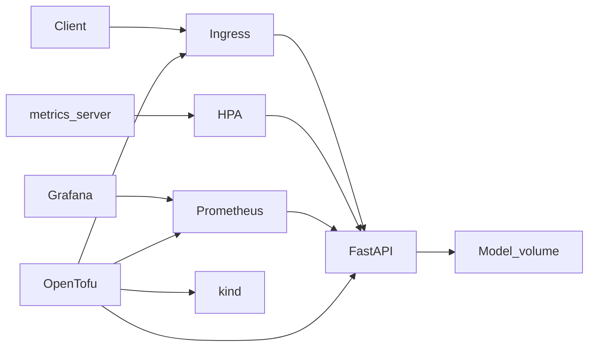

# k8s-ml-platform

A local Kubernetes laboratory for a small ML inference service. OpenTofu creates a kind cluster on your machine and installs the platform with the Kubernetes and Helm providers. The service is a FastAPI application. It serves a scikit-learn model that is trained when the container image is built. Prometheus and Grafana collect its metrics.

You can clone the repository and run it with Docker. It does not need a cloud account, a GPU, or a paid Terraform licence. It is a laboratory project for an infrastructure portfolio. It is not a production platform, and it does not schedule GPU workloads.

## Architecture



A client calls the service through ingress on `127.0.0.1`. The pod reads the model from a persistent volume. metrics-server feeds CPU numbers to the HorizontalPodAutoscaler. Prometheus scrapes the service, and Grafana reads Prometheus. OpenTofu creates the cluster and installs each of those parts.

## Quick start

You need Docker Engine, GNU Make, Bash, curl, and tar. Python 3.12 or newer is required for `make test` and `make load`. On Debian and Ubuntu, install the `python3-venv` package as well, because `make test` creates a virtual environment. The first `make up` downloads OpenTofu, kind, kubectl, Helm, TFLint, and kubeconform into `.tools`.

The full laboratory wants about 4 GB of free memory and about 8 GB of free disk. A machine with 2 CPU cores can run it. 4 cores is more comfortable. The first run downloads container images and can take 10 to 20 minutes.

```bash
make up
```

When the smoke test passes, the terminal prints the inference URL, the API key, and the Grafana password. The defaults are:

* Inference: `http://127.0.0.1:18080`
* API docs: `http://127.0.0.1:18080/docs`
* Grafana: `http://127.0.0.1:13000` (user `admin`)

Predict a job:

```bash
curl --silent --show-error \
  --header "Content-Type: application/json" \
  --header "X-API-Key: $(tofu -chdir=infra output -raw api_key)" \
  --data '{"gpu_count":2,"cpu_cores":16,"memory_gb":64,"runtime_hours":4,"priority":"normal","framework":"pytorch"}' \
  http://127.0.0.1:18080/predict
```

Send load and watch the autoscaler:

```bash
make load
```

Remove the cluster:

```bash
make down
```

If you want a smaller laboratory without Prometheus and Grafana, run `make up OBSERVABILITY=0`.

## What you should see

The smoke test checks four things.

* `GET /readyz` returns success. The ingress controller answers `/healthz` on the published port, so the smoke test uses the application readiness path.
* `POST /predict` without the API key returns HTTP 401.
* Three prediction examples return the CPU queue, the GPU queue, and the preemptible GPU queue.
* `GET /metrics` exposes `inference_requests_total`.

When observability is enabled, the smoke test also waits until the Grafana login page answers. In Grafana, open the dashboard named ML inference. It shows request rate, latency, ready replicas, and container CPU. Replica and CPU panels stay empty until Prometheus has scraped at least twice, which takes about a minute.

`make load` prints latency percentiles and the HorizontalPodAutoscaler. A successful run ends with more than one ready pod. The command exits with an error if the service does not scale.

## Repository layout

* `app/` contains the FastAPI service, the training code, the unit tests, and the multi-stage Dockerfile.
* `charts/inference/` is the Helm chart for the service.
* `infra/` contains the OpenTofu configuration, Helm values, and the vendored local-path provisioner manifest.
* `scripts/` contains tool installation, image loading, the smoke test, and the load test.
* `.github/workflows/ci.yml` is the GitHub Actions pipeline.

## Design decisions

OpenTofu is used instead of Terraform so the laboratory has no licence account. The configuration is ordinary HCL. The Kubernetes provider creates the namespaces. The Helm provider installs ingress, metrics-server, kube-prometheus-stack, and the inference chart. A local-exec step builds the inference image and loads it into the kind node, because the image is not pushed to a registry. The image pull policy is `Never`.

Platform images are listed in `infra/images.txt`. OpenTofu pulls each one on the host with crane and imports a single platform copy into the kind node before Helm starts. The node does not need to reach a registry. Ingress image digests are left empty so Kubernetes uses those local tags. A pinned multi-arch digest would send kubelet back to the registry.

The cluster is one kind node. That is small enough for a laptop and for a GitHub hosted runner. The node image is pinned. Published ports are bound to `127.0.0.1` only. After the node is ready, OpenTofu sets kube-proxy to nftables so Service routing uses the native nftables backend. The ingress controller joins the node network and listens on port 80. kind publishes that port as HTTP on 18080. Grafana uses NodePort 30180, published on port 13000. Grafana does not use a subpath.

The model is trained during `docker build` from a synthetic grid. No dataset is downloaded. The labels follow three rules. A request with no GPU goes to the CPU queue. A GPU request with low priority and a runtime of 12 hours or more goes to the preemptible GPU queue. Every other GPU request goes to the GPU queue. Framework, CPU count, and memory are part of the request because a real job record contains them. They do not change the label. The forest is trained to recover the rules, including on values that were not in the training grid.

The image also contains a copy of the model. An init container copies that file onto a PersistentVolumeClaim when the volume is empty. The volume uses the local-path provisioner and `ReadWriteOnce`. On this one node, several pods can mount it. A cluster with more than one node would need a volume that many nodes can mount.

A single prediction does not use enough CPU to trip the autoscaler. The service repeats the prediction. The repeat count is `PREDICT_REPEATS` in a ConfigMap. The default is 40. It is a demonstration control, not a property of the model. The HorizontalPodAutoscaler targets 50 percent of the 100 millicore request, with a minimum of 1 pod and a maximum of 3.

kube-prometheus-stack is installed with a small footprint. Alertmanager, the default recording rules, and the control plane component scrapes that do not work well on kind are turned off. Prometheus keeps 6 hours of data in an emptyDir. This is still a heavy add on. `OBSERVABILITY=0` leaves it out.

The inference namespace enforces the restricted pod security standard. The service runs as user 1000, with a read only root filesystem, a dropped capability set, and no service account token. Platform add ons stay in their own namespaces, because ingress, the storage provisioner, and node exporter need broader permissions.

Ingress NGINX was retired in March 2026. This laboratory still uses it. The chart publishes the service with an Ingress resource, and the kind documentation uses this controller. The container image remains available. It no longer receives security fixes. The follow up for a real cluster is the Gateway API.

The API key and the Grafana password are random strings created by OpenTofu. They are stored in the local state file. The state file is gitignored. This is not a secret manager.

## What each part shows

* OpenTofu and the kind provider show cluster creation as code, including pinned providers and a committed lock file.
* The Kubernetes provider shows namespace creation and the restricted pod security labels.
* Helm shows ingress, metrics-server, kube-prometheus-stack, and the application chart.
* The inference chart shows a Deployment, Service, Ingress, ConfigMap, Secret, PersistentVolumeClaim, resource requests and limits, startup, liveness, and readiness probes, a HorizontalPodAutoscaler, a NetworkPolicy, a ResourceQuota, and a LimitRange.
* The ServiceMonitor and the Grafana dashboard show a metrics path from the process to a dashboard.
* The Dockerfile shows a multi-stage build, a non root user, and a model trained at build time.
* GitHub Actions shows lint, unit tests, an image build, and an end to end job that creates kind, applies OpenTofu, and calls the endpoint.
* The load target shows the autoscaler moving from one pod to more than one pod.

## Tests and CI

`make test` runs pytest. The tests cover the labelling rules, the trained model, the HTTP API, authentication, metrics, and the volume seed helper.

`make lint` runs four checks.

* ruff, including format.
* `tofu fmt`, `tofu validate`, and TFLint.
* `helm lint`.
* kubeconform against the rendered chart, including the ServiceMonitor custom resource.

GitHub Actions runs those checks, builds the container image, and then runs `make up` on a hosted runner. The end to end job removes the cluster at the end, including when the smoke test fails.

## Configuration

The OpenTofu variables live in `infra/variables.tf`. The defaults are suitable for a laptop.

| Variable | Default | Purpose |
| --- | --- | --- |
| `cluster_name` | `k8s-ml-platform` | kind cluster name |
| `host_http_port` | `18080` | Ingress HTTP on the host |
| `host_https_port` | `18443` | Ingress HTTPS on the host |
| `grafana_host_port` | `13000` | Grafana on the host |
| `grafana_node_port` | `30180` | Grafana NodePort inside the node |
| `enable_observability` | `true` | Install Prometheus and Grafana |
| `node_image` | pinned kind node | Kubernetes 1.35 node image |

Changing a port recreates the cluster, because kind cannot edit port maps on a running node. Run `make down` before applying a port change if a previous cluster is still present.

Chart versions are pinned in `infra/locals.tf`. The inference chart values are in `charts/inference/values.yaml`.

Useful commands:

```bash
make test
make lint
make build
kubectl --kubeconfig infra/.kube/config get pods -A
kubectl --kubeconfig infra/.kube/config get hpa -n ml-inference
tofu -chdir=infra output
```

## Security notes

The laboratory binds published ports to `127.0.0.1`. Predict requires the `X-API-Key` header. Health, readiness, and metrics are open so kubelet probes and Prometheus can reach them. Do not expose this process on a shared network without a different authentication design.

The API key and the Grafana password are in the local OpenTofu state. Do not commit `infra/terraform.tfstate` or `infra/.kube/`. Both are gitignored. A real deployment would use a managed secret store.

The inference containers run as a non root user with a read only root filesystem. The namespace rejects pods that do not meet the restricted pod security standard.

## Troubleshooting

Docker must be running before `make up`. The command checks `docker info` and stops with a short message when it is not.

If port 18080 or 13000 is already in use, change `host_http_port` or `grafana_host_port` and create the cluster again.

If pods stay pending, look at `kubectl describe` and at free memory. The observability stack is the heavy part. `make up OBSERVABILITY=0` skips it.

If the autoscaler stays at one replica, wait until `kubectl top pods -n ml-inference` shows CPU numbers, then run `make load` again. metrics-server on kind needs the insecure kubelet flag that this configuration sets. The load test runs for 120 seconds by default. `LOAD_SECONDS=180 make load` waits longer.

If a pod reports `ErrImageNeverPull`, the image was not loaded into the node. Run `make up` again. OpenTofu rebuilds and loads the image when the application source changes.

If Grafana opens but the dashboard has no series, wait for two Prometheus scrapes, then run `make load`. The datasource uid in the dashboard file is `prometheus`, which matches the kube-prometheus-stack default.

## Next steps

1. Move the ingress from the retired Ingress NGINX controller to the Gateway API.
2. Add the NVIDIA device plugin and a pod that requests `nvidia.com/gpu`. This laboratory does not have a GPU and does not pretend to schedule one.
3. Explain the split between Slurm and Kubernetes. Batch training on a large GPU service is often scheduled by Slurm. Kubernetes fits the services around that system, including inference, dashboards, and cluster add ons. The Isambard AI service at the University of Bristol is a useful example for that discussion. This repository only shows the Kubernetes side.
4. Add a second node, and replace the ReadWriteOnce local volume with storage that many nodes can mount. An object bucket or a parallel filesystem is the usual model store.
5. Deploy the same chart with GitOps, for example Argo CD, instead of applying it from a laptop.
6. Replace local OpenTofu state with a managed secret store.
7. Replace the synthetic forest with a real exported model and a model registry. The serving path in this repository would stay the same shape.

## Curriculum vitae

This paragraph describes the project as it is. It does not claim a production GPU platform.

Built a local laboratory that deploys a small ML inference service on Kubernetes. OpenTofu creates a kind cluster and installs ingress, metrics-server, Prometheus, and Grafana with the Helm provider. The service is a multi-stage container image: a FastAPI application and a scikit-learn model trained at build time from synthetic job records. The Helm chart sets resource requests and limits, health probes, a HorizontalPodAutoscaler, a PersistentVolumeClaim, a NetworkPolicy, and an Ingress. GitHub Actions runs lint, unit tests, an image build, and an end to end deployment that calls the predict endpoint. The project does not schedule GPUs.

## Licence

MIT. See `LICENSE`.
